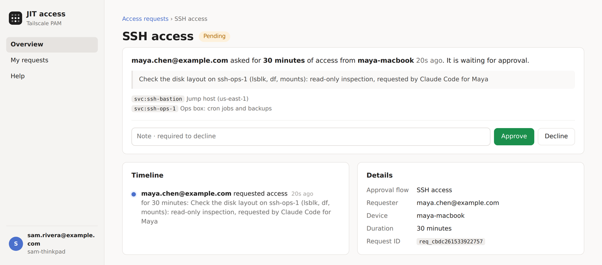

# Just-in-time access for people and agents, over Tailscale

Your agent needs the production database. It shouldn't have a standing
password for it, and neither should you.

With this, Claude Code asks for access the way a colleague would:
*"read-only on orders, 30 minutes, to check last night's refunds."* It gives
you a link, and someone approves it in the browser. Claude then connects.
Tailscale PAM injects the credentials along the way, so the agent never
sees a secret. When the time is up, the access is gone, and every request
and approval is on the record.

It works with whatever Tailscale PAM can put in front of: SSH, databases
(MySQL, PostgreSQL, MongoDB, MS SQL, CockroachDB, Elasticsearch),
Kubernetes, RDP, VNC, HTTP, TCP and AWS S3.

## See it in action


**[Watch the full video (MP4, 2:20)](docs/demo.mp4)**: why agents need just-in-time access, the demo with the approval in the browser, and what you get.

Meanwhile, the approver opens the link and sees this:



*Recorded with the real Claude Code and plugin, against jitd's demo mode:
made-up people (Maya asks, Sam approves) and a stand-in for the ops host.*

> **Experimental.** This is a working proof of concept, tested on a real
> tailnet. Expect rough edges.
>
> **Not an official Tailscale project.** This is an independent project and
> is not affiliated with, endorsed by, or supported by Tailscale Inc. It
> uses Tailscale's public APIs and features.

## How it fits together

There are two parts:

| | What it is | Who sets it up |
|---|---|---|
| **[jitd](jitd/README.md)** | The approval desk: approval flows, a web page to ask and approve, an API, and an MCP server at `http://jit/mcp`. It runs as its own machine on your tailnet. | A tailnet admin, once |
| **Your MCP client** | Claude Code, VS Code, Claude Desktop or anything else that speaks MCP, pointed at `http://jit/mcp` with one command. Nothing runs on your machine: jitd knows who you are from your Tailscale connection, and it tells the agent how to use the tools. | Everyone, once per machine |

People can use jitd from the browser without any of that.

Under the hood, an approval sets a custom posture attribute (for example
`custom:jit_db_ro`) with an expiry on the requester's device. Your tailnet
policy decides what that attribute unlocks, including PAM permissions such
as read-only on a database. When the attribute expires, Tailscale removes
it and the access ends.

## Get started

### 1. Run jitd (an admin, once per tailnet)

Follow **[jitd/README.md](jitd/README.md)**. It takes you through it step by
step:

1. Add a `group:jit-admins` group and let people reach `tag:jit` in the policy.
2. Create an auth key (tagged `tag:jit`) and an OAuth client.
3. Run jitd: on a Mac to try it out, or on a small EC2 instance as a
   systemd service to keep it.
4. Check that it works at http://jit/admin/setup.
5. Create an approval flow.
6. Paste the policy snippet jitd gives you.

jitd is a single self-contained binary, with the web UI built into it:
download it from the
[releases page](https://github.com/atoonk/tailscale-jit/releases) and run
it. There is nothing to clone and no Go needed, unless you want to work on
jitd itself. Moving to a later release is replacing that one file and
restarting — see
[Upgrading to a new release](jitd/README.md#upgrading-to-a-new-release).

### 2. Connect Claude Code (everyone, once per machine)

You need:

- Tailscale **1.98 or newer**, running and logged in on the machine where
  Claude Code runs. (Claude Code on the web can't use it: the tools need a
  device on the tailnet.)
- jitd running on your tailnet, normally at `http://jit` (see below if
  yours has another name).

Then, from a shell:

```sh
claude mcp add --transport http --scope user jit http://jit/mcp
```

That's it: no download, no login. Run `/mcp` in Claude Code and you should
see `jit` connected, with five tools: `list_requestable`, `request_access`,
`wait_for_access`, `get_access_request` and `cancel_access_request`. The
server is jitd itself, over the tailnet: it knows who you are from your
Tailscale connection, and it sends Claude the instructions on how to use
the tools (ask for the narrowest access, show you the approval link and
wait for you to approve it, connect without credentials).

Try asking: *"What's in the orders database? I don't think I have access
yet."*

A few tips:

- **jitd lives somewhere other than `http://jit`?** That happens when
  another machine was already called `jit` (jitd then joins as `jit-1`) or
  when jitd runs with `-hostname` or `-https`. jitd's Help page (`/help`)
  prints the exact command for its own address; use that URL in place of
  `http://jit/mcp`.
- **Installed the old tailscale-pam plugin?** It still works (it is only a
  pointer to the same server), but the plain command above replaces it.
  Remove it with `/plugin uninstall tailscale-pam@tailscale-jit` so the
  tools don't show up twice.
- **Curious what this machine can reach?** Run `tailscale service list`
  (add `--json`). Claude runs the same command.

### Other MCP clients

Any MCP client on the tailnet can use `http://jit/mcp` (Streamable HTTP, no
login); jitd knows who you are from the connection. There is no approve
tool.

- **VS Code** (`.vscode/mcp.json`): `{"servers": {"jit": {"type": "http", "url": "http://jit/mcp"}}}`.
- **Claude Desktop** only starts local servers, so it needs a small
  stdio-to-HTTP bridge on your machine. [mcp-remote](https://github.com/geelen/mcp-remote)
  does that (Node 20 or newer). In `claude_desktop_config.json`:

  ```json
  {"mcpServers": {"jit": {"command": "npx", "args": ["-y", "mcp-remote@0.16.5", "http://jit/mcp", "--transport", "http-only", "--allow-http"]}}}
  ```

  Drop `--allow-http` when jitd serves HTTPS. Claude Desktop's own remote
  connectors won't do: they call from Anthropic's cloud, which can't reach
  a tailnet-only jitd.

Hosts that render [MCP Apps](https://modelcontextprotocol.io/extensions/apps/overview)
get each request as a card that follows the approval, and a form to pick a
flow and ask. That is verified so far only with jitd's own test host in the
preview (`/mcp-host`); VS Code, Goose and Claude Desktop announce the
extension but have not been seen rendering it yet. Everyone else, Claude
Code included, gets the same as text.

## Good to know

- **Reaching a service isn't permission to do everything on it.** The PAM
  permissions in the policy grant still apply: a read-only grant refuses
  writes.
- **Access is per device.** The attribute goes on the device that asked, so
  everyone and everything on that device has the access while it lasts.
- **jitd is only reachable from its tailnet.** `http://jit` resolves on
  devices logged in to the tailnet that runs it and nowhere else, so from
  another network, or another tailnet, it simply looks down. If you have
  more than one tailnet, check which one the device is on.
- **Agents ask; people approve.** The MCP server has no approve tool.
  However, the agent runs as you. On a flow that lets people approve their
  own requests, only its instructions stop it from approving with `curl`.
  Keep self-approval off for anything that matters.

## Working on it

This is for changing jitd. To *run* it, take a release binary as above; the
repository isn't needed for that.

jitd is one Go program. You need Go 1.26.6 or newer:

```sh
go test ./...
go build -o bin/jitd ./jitd
go run ./jitd/preview       # the jitd UI with made-up people, no tailnet needed
```

`bin/` is ignored by git, so it is also where a released binary can go when
you want to run one without compiling (pick your platform's file, and
`darwin` in place of `linux` on a Mac):

```sh
mkdir -p bin
curl -fsSLo bin/jitd https://github.com/atoonk/tailscale-jit/releases/latest/download/jitd-linux-arm64
chmod +x bin/jitd
```

Start it as [jitd/README.md](jitd/README.md) describes: the credentials and
the auth key are the same either way.

Compiling needs roughly 2 GB of free memory. To publish binaries, push a
tag such as `v0.7.0`: the Release workflow runs the tests, builds `jitd`
for Linux and macOS (amd64 and arm64) and attaches the binaries, with
checksums, to a GitHub release. A tag with a suffix (`v0.7.0-rc1`) becomes a
prerelease; running the workflow by hand from the Actions tab builds the
same binaries as a workflow artifact without releasing.

The `plugins/` directory holds the retired Claude Code plugin: a pointer to
`http://jit/mcp` kept so existing installs keep working.

## License

[Apache License 2.0](LICENSE).

Tailscale is a trademark of Tailscale Inc. This project is not affiliated
with or endorsed by Tailscale Inc.
